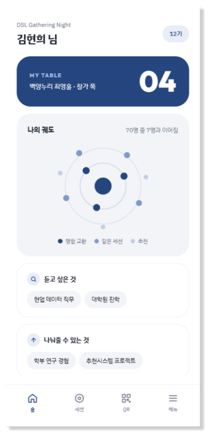
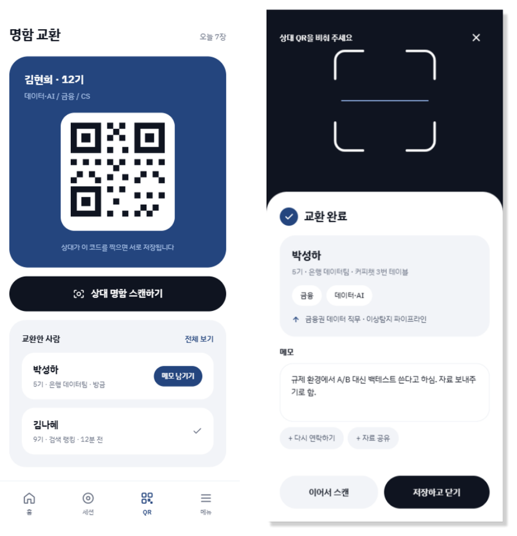
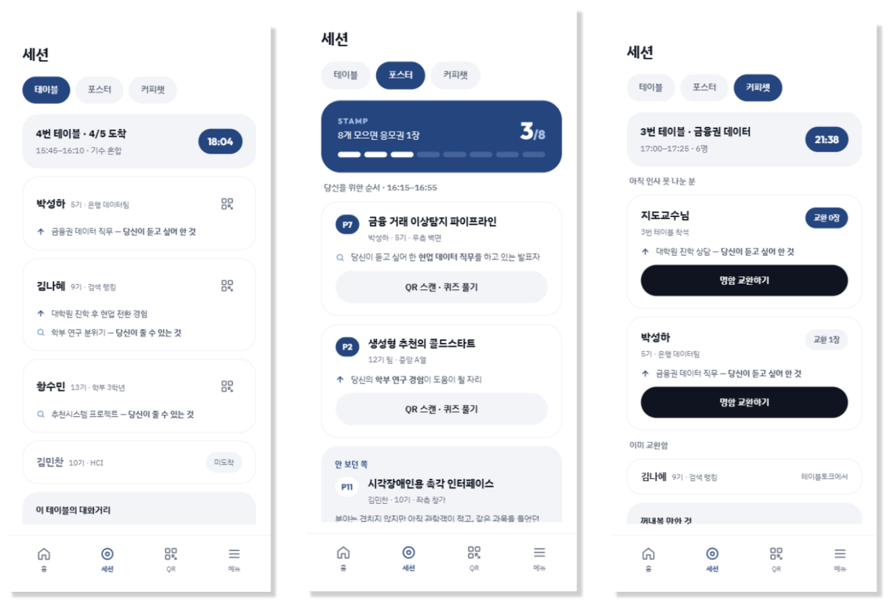
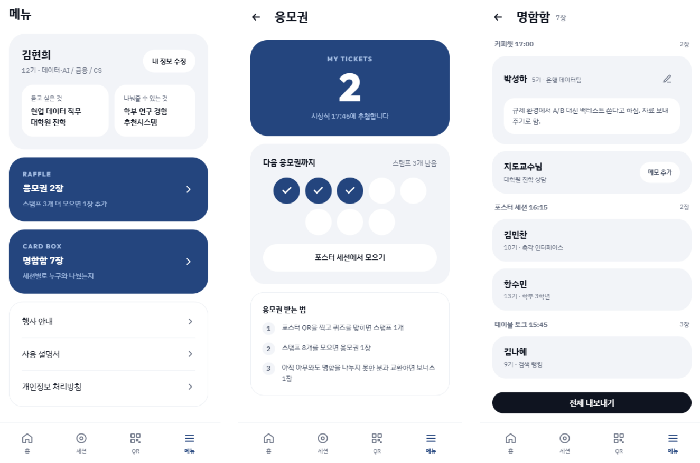
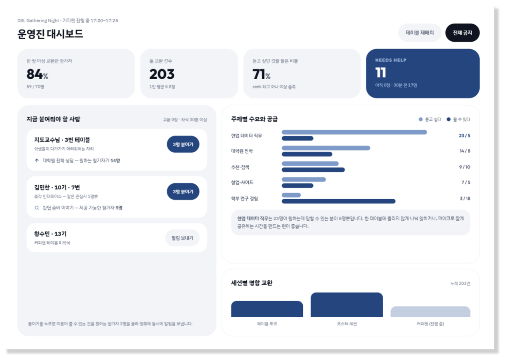

# Semantic ID 튜닝을 통한 콜드 스타트 해소

**15기** 박성하 · 황수민  ·  **16기** 김나혜 · 김민찬 · 김현희

DSL 26-2 Modeling — RecSys (생성형 추천)

📑 발표자료: [`26-2_Modeling_RecSys_발표자료.pdf`](26-2_Modeling_RecSys_발표자료.pdf)

---

## Project Overview

생성형 추천 모델 **TIGER**는 아이템마다 붙인 짧은 코드, **Semantic ID(SID)** 를 한 자리씩 생성해 다음 아이템을 맞힙니다.
SID는 아이템 설명 텍스트를 임베딩한 뒤 잔차 양자화(RQ-KMeans)로 만들기 때문에, 비슷한 아이템끼리 앞자리를 공유하는 "의미 있는 주소"가 됩니다.

> 텍스트만 보고 만든 주소에는 **"누가 무엇을 같이 샀는지"(협업 신호)가 없다.**
> 그래서 상호작용이 적은 **신규·비인기(콜드) 아이템**은 추천에 거의 잡히지 않는다.
> 주소를 만들기 **전에** 그래프 이웃 정보를 넣으면 콜드 아이템이 더 잘 추천될까?

TIGER의 모델 구조와 학습은 그대로 두고, **아이템의 주소만 바꾸는** 학습 파라미터 없는 전처리(**Graph SID, G-SID**)를 제안했습니다.
Amazon Beauty(실데이터)와 자체 구축한 구인구직 데이터셋, 두 도메인에서 검증한 뒤 같은 구조의 문제를 가진 **학회 네트워킹 행사 매칭 서비스**로 확장했습니다.

| 구분 | 텍스트 SID | Graph SID (ours) |
|---|---|---|
| 주소를 만드는 정보 | 아이템 설명 문장 | 설명 문장 + 같이 소비된 이웃 |
| 가까운 주소 | 설명이 비슷한 아이템끼리만 | 같이 소비되는 아이템끼리도 |
| 이웃이 없는 아이템 | — | 원래 텍스트 임베딩 그대로 → 텍스트 SID로 자연 복귀 |

---

## Pipeline

```
Amazon Beauty · 구인구직(생성)
        │  전처리                 preprocessing/ · data_gen/
        ▼  Split A (LOO) · Split B (Temporal W3/W4/W5)
        │  텍스트 → 임베딩        GRID (flan-t5-xl encoder, 2048차원)
        ▼
   ┌────┴────┐  주소 만들기
 텍스트 SID   G-SID (그래프 직교 주입, β₀=1.0)       Tokenization/
   └────┬────┘  GRID RQ-KMeans, 코드북 256 × 4단계 + 충돌 구분자
        ▼  학습                  TIGER (code/server/tiger_beauty.sh)
        ▼  덤프 → 채점           code/server/tiger_eval_dump.sh → code/tiger_to_eval.py → results/*.json
        ▼  판정                  code/verdict_*.py  (시드 평균 · 노이즈 바닥 · 짝지은 t · G1 대조)
```

| 단계 | 스크립트 | 입력 | 출력 |
|---|---|---|---|
| 전처리 | `preprocessing/repreprocess.py` | `Data/*.json.gz` (Amazon Beauty) | `Beauty_split_A.pkl` · `Beauty_split_B.pkl` · `Beauty_related_separate.pkl` |
| 텍스트 임베딩 | `code/server/embed_beauty.sh` (GRID) | 아이템 메타 텍스트 | `embeddings/beauty_A/merged_predictions_tensor.pt` |
| 그래프 증강 | `Tokenization/graph_sid_augment.py` · `Tokenization/gen_gstar_beta.py` | 텍스트 임베딩 + 관계 간선 | `embeddings/graph_A/*.pt` |
| SID 발급 | `code/server/sid_beauty.sh` (GRID RQ-KMeans) | 임베딩 | `sid/**/sid_tensor.pt` |
| 추천 학습 | `code/server/tiger_beauty.sh` | SID + 시퀀스 | TIGER 체크포인트 |
| 평가·판정 | `code/tiger_to_eval.py` · `code/verdict_*.py` | 예측 덤프 | `results/**/*.json` · `results/reports/*.txt` |

### 그래프 만들기

- 노드 = 아이템, 간선 = `also_bought` · `also_viewed` · `bought_together` (무방향)
- 인기도로 head / tail 을 나누고 희귀 아이템과 이어지는 간선에 가중치를 더 줌 — head–head 0.5, **head–tail 1.5**, tail–tail 1.0
- 이웃 가중평균 `mᵢ = Σ wᵢⱼ xⱼ / Σ wᵢⱼ` → "나와 같이 소비되는 아이템들의 평균 모습"
- **중심화(μ 빼기)**: 임베딩 전체 평균 μ가 너무 커서 RQ-KMeans 의 정규화 단계에서 모든 방향이 한쪽으로 뭉침(1단계에서 에너지 83.8% 소실). 평균을 먼저 빼야 이웃 신호가 주소까지 살아남습니다.

### 튜닝식 — 직교 주입 (β₀)

| | 식 | 성질 |
|---|---|---|
| 고전 블렌딩 | `z = (1 − α)·x + α·m` | 이웃을 섞을수록 원래 텍스트 정보가 줄어든다 |
| **직교 주입 (ours)** | `z = x̃ + β₀‖x̃‖·unit(m⊥)` | 새 정보만 더함 → 원래 텍스트 성분 보존 |

- `x̃ = x − μ` (중심화), `m⊥` = m 에서 "나와 같은 방향"을 뺀 성분
- `β₀` = 회전각 조절 노브 (`tan θ = β₀`, β₀ = 1.0 → 45°). 이웃이 없거나 이웃 평균이 나와 평행하면 주입하지 않음
- **β₀ = 1.0 선택 규칙 (실행 전에 고정)**: recall@50·APLT@50 이 텍스트 SID 이상이고 코드북 붕괴가 없는(최저층 비트 ≥ 4.0) 후보 중 콜드 recall@50 최대

### 모델

| 모델 | 역할 |
|---|---|
| **TIGER** (Rajput et al., NeurIPS 2023) | 생성형 추천 본체. 사용자가 본 아이템들의 SID 시퀀스 → 다음 아이템 SID를 한 자리씩 생성. 30k 스텝 |
| **GRID** (Snap Research, 2025) | 임베딩 · RQ-KMeans · TIGER 학습 코드베이스 (팀 패치 2건, `patches/`) |
| MaskGR · CRAB | 대조군 (마스크 확산 / 코드북 재균형) — 둘 다 이득 없음 |

### 데이터

- **Amazon Beauty** (McAuley et al., SIGIR 2015) — 사용자 22,363 · 아이템 12,101 · 관계 간선 403,716
  - Split A: Leave-One-Out (5시드) · Split B: Temporal 윈도우 W4·W5 (3시드)
- **구인구직 v3·v4 (자체 구축)** — 채용담당자(user) → 후보자(item) 추천, 콜드 = 신규 가입자 (6시드)
  - 고용노동부 고용24 직업정보 공공데이터로 프로필을 만들고, v4 는 Kaggle CareerBuilder 실측 분포로 상호작용 시뮬레이터를 재보정
  - 구축 과정과 게이트(G0~G4)는 [`data_gen/README.md`](data_gen/README.md)

### 실험 설계 — 시드 1개 수치는 믿지 않는다

| 장치 | 내용 |
|---|---|
| **노이즈 바닥** | 시드만 바꿨을 때 흔들리는 폭. 이보다 작은 차이는 주장하지 않음 |
| **짝지은 t검정** | 같은 시드끼리 차이를 비교 (6시드 기준 t > 2.015 면 유의) |
| **G1 무작위 그래프 대조** | 차수를 유지한 채 간선만 무작위 재연결 → 이득이 사라져야 "그래프 의미" 덕분 |
| **사전 고정 판정** | 판정 규칙을 실행 전에 고정하고 자동 채점 (`code/verdict_*.py`) |

---

## Output / Evaluation

> 그래프 주소는 **두 도메인 · 세 트랙 · 세 학습 예산**에서 일관되게 텍스트 주소보다 낫다.

### 주요 결과

| 지표 | 텍스트 SID | Graph SID | 변화 | 신뢰도 |
|---|---|---|---|---|
| Beauty NDCG@10 | 0.0373 | **0.0416** | **+12%** | 5/5 시드 부호 일치, 노이즈 바닥 1.6배 |
| Beauty 콜드 아이템 recall@50 | 0.0422 | **0.0625** | **+48%** | 5/5 시드 같은 방향 |
| 구인구직 v4 정확도 4지표 | — | — | 전부 유의 (NDCG@10 t = 11.4) | 6/6 시드, G1 대조 통과 |
| 구인구직 v4 콜드 recall@50 | — | — | **+25%** | 6시드 |

### 재현성

| 검증 | 결과 | 판정 |
|---|---|---|
| 세 트랙 (LOO · Temporal W4 · W5) | W4 +0.0024, W5 +0.0022 (NDCG@10), 각 3/3 부호 일치 | ✅ 재현 |
| 학습 예산 (15k · 30k · 45k) | 15k +0.0061, 45k +0.0054, 30k(5시드) +0.0044 | ✅ 예산과 무관 |
| 접두사 제약 디코딩 | 무효 SID 1.3~1.7% → 0, 그래프 우위 유지 | ✅ 균열 없음 |

### 한계

- 구인구직 **v3** 주지표(NDCG@10)는 미확인 (t = 1.34, 기준 2.015). recall@50·ndcg@50 만 유의
- 다양성(롱테일 노출, APLT@50) 개선은 노이즈 바닥 아래 → 측정 불가
- 튜닝식(β₀ 1.0) vs 고전 블렌딩(α 0.7)은 구분 불가 → **동등**. 튜닝식의 강점은 해석 가능성
- **zero-shot 아이템은 여전히 0** — 원인은 디코더가 아니라 SID 주소 할당 커버리지

### 결론

> 학습 파라미터를 하나도 추가하지 않고 **주소만 바꿔서** 콜드 아이템 recall 을 끌어올릴 수 있다.
> 다만 한 번도 등장하지 않은 아이템(zero-shot)은 주소 할당 단계에서 막히며, 이는 다음 과제로 남는다.

자세한 수치: [`docs/RESULTS_요약_0920.md`](docs/RESULTS_요약_0920.md) · [`docs/RESULTS_실험표.md`](docs/RESULTS_실험표.md) · [`docs/SHARE_GSID_결과요약.md`](docs/SHARE_GSID_결과요약.md) · [`docs/JOBS_결과정리.md`](docs/JOBS_결과정리.md) · [`results/reports/`](results/reports/)

---

## Service — 네트워킹 행사 매칭 서비스

### 같은 구조의 문제를 다른 도메인에서

| 추천시스템 | 네트워킹 행사 |
|---|---|
| 노출되지 않은 아이템은 클릭 기록이 없다 | 말을 걸지 않은 사람은 대화 기록이 없다 |
| 정확도를 높일수록 인기 아이템만 추천된다 | 정보가 없으면 아는 사람 · 눈에 띄는 사람에게 간다 |
| 롱테일은 발견될 가능성이 희박하다 | 유의미한 대화 없이 귀가하는 참가자 발생 |

> **탐색 비용을 시스템이 지불하고, 아무도 혼자 남지 않게 연결을 분배하는 네트워킹 매칭 서비스**
> — 2026 DSL Gathering Night *The ORBIT* (10/31, 연세대 백양누리) 적용을 목표로 설계

오프라인 개더링 행사에서 사전 설문으로 참가자를 공통 관심사 테이블에 배정하고, 행사 당일 네트워킹을 **앱 설치 없이 QR 로그인하는 모바일 웹** 하나로 이어 줍니다.

### 사람 추천 이론

| 장치 | 내용 | 근거 |
|---|---|---|
| **상호 추천** | 내가 찾는 것(Seek) ↔ 상대가 가진 것(Offer)을 양방향으로 따로 재고 낮은 쪽을 점수로: `score(A,B) = min(cos(S_A, O_B), cos(S_B, O_A))` (e5-small 임베딩) | 스피드데이팅 실험 (Fisman & Iyengar), RECON (RecSys 2010) |
| **탐색 칸 · 노출 상한** | 추천 12명 중 2명은 아직 덜 추천된 사람, 한 사람은 최대 15번까지만 추천. 몰림(Gini) 0.334 → 0.229 (채용 데이터) | CareerBuilder · 스피드데이팅 시뮬레이션 |
| **추천 갱신** | 테이블토크·포스터 만족도 답(1 / 0.33 / 0 / −0.2)에 따라 Seek 벡터를 상대의 Offer 쪽으로 `0.5 × 가중치`만큼 이동 | Rocchio (Manning 외, 2008), Burges 외 2005, Krosnick 외 2002 |
| **SID 표시** | 주소(8칸 × 3층)는 점수 계산엔 쓰지 않고 이름표 · 명함 · 궤도 · 추천 이유에 표시 | 본 프로젝트 |
| **콜드스타트 대응** | 대화 기록 없이 소개 문장만으로 첫 테이블 배정, 현장 등록자는 미리 만든 주소 기준표에 바로 붙임(재학습 없음) | 본 프로젝트 |

### 주요 기능

- **궤도 시각화** — SID 발급 결과로 나와 비슷한 관심 분야 · 요구를 가진 참가자를 한눈에
- **세션별 추천** — 테이블토크 자리 배정, 포스터 스탬프 투어(QR 퀴즈), 커피챗 상대 12명 추천 + 추천 근거 · 대화 주제
- **명함 발급 및 교환** — 모바일 명함, QR 스캔 교환, 메모
- **행사 이벤트** — 스탬프 → 응모권 추첨
- **운영진 대시보드** — 교환 현황, 주제별 수요 · 공급, "지금 붙여줘야 할 사람"

### 데모

| 홈 | 명함 교환 |
|---|---|
|  |  |

**세션별 추천 (테이블 · 포스터 · 커피챗)**



**메뉴 (응모권 · 명함함)**



**운영진 대시보드**



실제 학회 연명부(243명, 익명 집계만 저장)로 SID 발급과 테이블 배치를 시험한 기록은 [`event_demo/README.md`](event_demo/README.md) 에 있습니다.
G-SID 배치는 무작위 300회 대비 z = 14.9 로 뚜렷하게 뭉쳤고, 프로필만으로 만든 그래프는 텍스트와 겹쳐(G0 0.93) 행사에서는 **상호작용 기반 그래프**가 필요하다는 한계도 함께 적었습니다.

---

## Repository Structure

```
26-2_Modeling_RecSys/
├── README.md
├── 26-2_Modeling_RecSys_발표자료.pdf   # 최종 발표자료
├── assets/                  # README 데모 이미지
│
├── Tokenization/            # ★ G-SID 핵심 — 그래프 증강 · 직교 주입 튜닝식
│   ├── graph_sid_augment.py     #   그래프 구성, head/tail 가중치, 중심화, 고전 블렌딩
│   ├── gen_gstar_beta.py        #   직교 주입 β₀ 스윕
│   └── compare_sid_variants.py  #   SID 변형 비교
├── preprocessing/           # Amazon Beauty 전처리 (+ 설계·수정 문서)
├── data_gen/                # 구인구직 생성 데이터셋 v3·v4 (고용24 + 시뮬레이터, 게이트 G0~G4)
├── code/                    # 평가 하네스 · 제출/채점/판정 스크립트 (→ code/README.md)
│   └── server/              #   GPU 서버 sbatch 스크립트 (임베딩 · SID · TIGER · 덤프)
├── event_demo/              # 행사 서비스 — 프로필 → 임베딩 → G-SID → 테이블 배치 시뮬레이션
├── crab/                    # CRAB 코드북 재균형 (대조군)
├── patches/                 # GRID 패치 기록
├── GRID/  MaskGR/           # 업스트림 스냅샷 (snap-research)
│
├── embeddings/              # 텍스트 · 그래프 증강 임베딩 (.pt)
├── sid/                     # 발급된 SID 텐서 (.pt)
├── results/                 # 지표 JSON · 자동 판정 보고서 (→ results/README.md)
├── tiger_runs/              # TIGER 학습 곡선
├── csv_export/              # 엑셀용 CSV (데이터셋 · 임베딩 · SID · 학습 곡선)
├── docs/                    # 보고서 · 인수인계 · 실험 기록 (→ docs/README.md)
├── Data/                    # Amazon Beauty 원본
├── Beauty_split_A.pkl  Beauty_split_B.pkl  Beauty_related_separate.pkl   # 분할 파일 (코드 기본값)
└── _archive/                # 안 쓰지만 지우지 않은 것
```

### 문서 길잡이

| 나는… | 읽을 것 |
|---|---|
| 결과 수치를 한 장으로 본다 | [`docs/RESULTS_요약_0920.md`](docs/RESULTS_요약_0920.md) — 전 실험 지표·판정 한 장 |
| 결과 수치를 확인한다 | [`docs/RESULTS_실험표.md`](docs/RESULTS_실험표.md) · [`results/README.md`](results/README.md) |
| 행사 서비스 백엔드를 만든다 | [`docs/BACKEND_설계계획.md`](docs/BACKEND_설계계획.md) · [`event_demo/README.md`](event_demo/README.md) |
| 그래프 SID 를 만든다 | [`docs/HANDOFF_graph_sid.md`](docs/HANDOFF_graph_sid.md) · [`csv_export/sid/gstar_noTau_k0_b10/README.md`](csv_export/sid/gstar_noTau_k0_b10/README.md) (승자 수식) |
| 구인구직 데이터셋을 이해한다 | [`data_gen/README.md`](data_gen/README.md) → [`docs/PREREG_생성데이터셋.md`](docs/PREREG_생성데이터셋.md) → [`docs/DATASET_v4_파이프라인.md`](docs/DATASET_v4_파이프라인.md) |
| 코드를 고친다 | [`code/README.md`](code/README.md) — 의존 관계 · 실행 순서 · 반복해서 당한 함정 |
| 전체 문서 분류가 필요하다 | [`docs/README.md`](docs/README.md) |

---

## Usage

```bash
# 0. 환경 (로컬 분석·지표 계산용, GPU 불필요)
conda create -n eval python=3.9 -y && conda activate eval
pip install -r requirements.txt
make check                                  # 의존성 · 분할 파일 확인

# 1. 그래프 증강 임베딩 만들기 (로컬, 저장소 안 파일만 사용)
python Tokenization/graph_sid_augment.py    # → embeddings/graph_A/
python Tokenization/gen_gstar_beta.py       # 직교 주입 β₀ 스윕

# 2. SID 발급 · TIGER 학습 (GPU 서버, 옵션은 각 스크립트 머리 주석)
bash code/server/sid_beauty.sh
bash code/server/tiger_beauty.sh
bash code/server/tiger_eval_dump.sh

# 3. 채점 · 판정
python code/tiger_to_eval.py --pred <덤프.pkl> --sid <sid.pt> --label <이름>
python code/tiger_to_eval.py ... --split Beauty_split_B.pkl --window W5     # Temporal
python code/verdict_gsid_week.py                                           # 시드 판정

# 4. 행사 서비스 시뮬레이션
python event_demo/02_embed.py && python event_demo/03_graph_sid.py && python event_demo/04_table_sim.py
```

> GRID · MaskGR 는 각자 `requirements.txt` 가 있으며, torch 버전이 충돌하므로 conda 환경을 분리해서 쓰세요.
> `event_demo` 의 원본 연명부(개인정보)는 저장소에 포함하지 않습니다.

## Requirements

```
python 3.9
torch>=2.0,<3
numpy>=1.24,<2
scipy>=1.10
pandas>=2.0
tensorflow>=2.13,<2.17     # TFRecord 변환(to_grid_*.py)에만 필요
sentence-transformers  scikit-learn   # event_demo (intfloat/multilingual-e5-small)
```

---

## References

1. Rajput et al. *Recommender Systems with Generative Retrieval (TIGER).* NeurIPS 2023. [arXiv:2305.05065](https://arxiv.org/abs/2305.05065)
2. Ju et al. *Generative Recommendation with Semantic IDs: A Practitioner's Handbook (GRID).* Snap Research, 2025. [arXiv:2507.22224](https://arxiv.org/abs/2507.22224)
3. Wang et al. *LETTER: Learnable Item Tokenization for Generative Recommendation.* CIKM 2024. [arXiv:2405.07314](https://arxiv.org/abs/2405.07314)
4. Liu et al. *MMGRec: Multimodal Generative Recommendation with Transformer Model.* 2024. [arXiv:2404.16555](https://arxiv.org/abs/2404.16555)
5. Liu, Zhang, Cheung. *MoToRec.* AAAI 2026. [arXiv:2602.11062](https://arxiv.org/abs/2602.11062)
6. Qu et al. *TokenRec.* 2024. [arXiv:2406.10450](https://arxiv.org/abs/2406.10450) / Wang et al. *ColaRec.* CIKM 2024. [arXiv:2403.18480](https://arxiv.org/abs/2403.18480)
7. Han et al. *Restoring Collaborative Signals in Semantic-ID Generative Recommendation via Personalized Natural Language.* 2026. [arXiv:2607.27682](https://arxiv.org/abs/2607.27682)
8. Wang, He, Li, Sundaram. *Understanding Semantic IDs: From Item Representation to Item Selection.* 2026. [arXiv:2607.24995](https://arxiv.org/abs/2607.24995)
9. Peng et al. *Can Generative Recommendation Reach Cold Items? A Temporal Perspective on SID Generation.* 2026. [arXiv:2607.21101](https://arxiv.org/abs/2607.21101)
10. Zhang et al. *Cold-Starts in Generative Recommendation: A Reproducibility Study.* 2026. [arXiv:2603.29845](https://arxiv.org/abs/2603.29845)
11. Zhang et al. *How Reliable Are SID Tokenizer Comparisons?* 2026. [arXiv:2605.25330](https://arxiv.org/abs/2605.25330)
12. Penha et al. *Semantic IDs for Joint Generative Search and Recommendation.* RecSys 2025. [arXiv:2508.10478](https://arxiv.org/abs/2508.10478) — 5시드 · 짝지은 t검정 프로토콜
13. Fan et al. *CRAB: Codebook Rebalancing for Bias Mitigation in Generative Recommendation.* 2026. [arXiv:2604.05113](https://arxiv.org/abs/2604.05113)
14. McAuley et al. *Image-based Recommendations on Styles and Substitutes* (Amazon 리뷰 데이터). SIGIR 2015
15. Kaggle. *Job Recommendation Challenge* (CareerBuilder), 2012 / 고용노동부 고용24 직업정보 공공데이터
